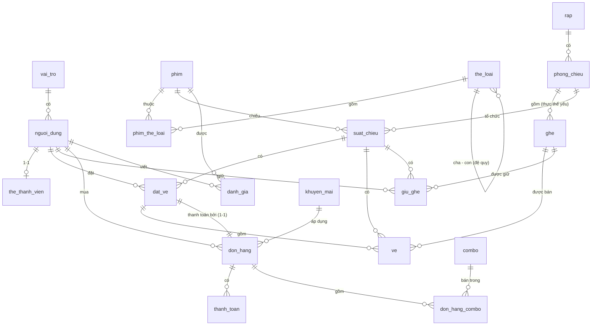

# ERD ban đầu: DT03 Đặt vé xem phim

Bản phác để B (Trần Đăng Long) chỉnh lại và ghép thành ERD chính thức. Gồm **20 bảng** (đề yêu cầu >= 12 bảng, ERD >= 10 thực thể).

## 1. Sơ đồ quan hệ



Các loại quan hệ đề yêu cầu:
- **1-1**: `nguoi_dung` - `the_thanh_vien`; `dat_ve` - `don_hang`.
- **1-n**: `rap` - `phong_chieu`, `phim` - `suat_chieu`, `dat_ve` - `ve`, ...
- **n-n**: `phim` - `the_loai` (qua `phim_the_loai`); `don_hang` - `combo` (qua `don_hang_combo`).
- **Thực thể yếu**: `ghe` phụ thuộc `phong_chieu` (khóa tự nhiên `phong_id + hang + so`).
- **Quan hệ đệ quy**: `the_loai.parent_id` trỏ về `the_loai.id`.

## 2. Danh sách bảng và cột

Ký hiệu: **PK** khóa chính, **FK** khóa ngoại, **UQ** duy nhất, **NN** not null.

### A (Phong Ngọc Tiến): Đặt vé và ghế

**dat_ve** (một lần đặt, gồm nhiều vé)

| Cột | Kiểu | Ghi chú |
|---|---|---|
| id | serial | PK |
| nguoi_dung_id | int | FK `nguoi_dung`, NN |
| suat_chieu_id | int | FK `suat_chieu`, NN |
| trang_thai | enum | `CHO_THANH_TOAN`, `DA_XAC_NHAN`, `DA_HUY`, `HET_HAN` |
| tao_luc | timestamptz | mặc định `now()` |
| het_han_luc | timestamptz | hạn giữ chỗ chờ thanh toán |

**ve**

| Cột | Kiểu | Ghi chú |
|---|---|---|
| id | serial | PK |
| dat_ve_id | int | FK `dat_ve` |
| suat_chieu_id | int | FK `suat_chieu` (lặp lại có chủ ý, xem mục 4) |
| ghe_id | int | FK `ghe` |
| gia | numeric(12,0) | giá tại thời điểm mua |
| trang_thai | enum | `DA_DAT`, `DA_XUAT`, `DA_HUY` |
| | | **UQ(suat_chieu_id, ghe_id)** chặn trùng ghế |

**giu_ghe** (giữ ghế tạm thời)

| Cột | Kiểu | Ghi chú |
|---|---|---|
| id | serial | PK |
| suat_chieu_id, ghe_id | int | FK; **UQ(suat_chieu_id, ghe_id)** |
| nguoi_dung_id | int | FK người đang giữ |
| tao_luc, het_han_luc | timestamptz | hết hạn thì giải phóng |

### B (Trần Đăng Long): Phim, rạp, phòng, suất chiếu

| Bảng | Cột chính | Khóa, ràng buộc |
|---|---|---|
| **phim** | id, ten_phim, mo_ta, thoi_luong, ngay_khoi_chieu, gioi_han_tuoi | CHECK `thoi_luong > 0` |
| **the_loai** | id, ten, parent_id | FK tự tham chiếu, UQ(ten) |
| **phim_the_loai** | phim_id, the_loai_id | PK ghép |
| **rap** | id, ten_rap, dia_chi, thanh_pho, so_dien_thoai | |
| **phong_chieu** | id, rap_id, ten_phong, loai_phong | UQ(rap_id, ten_phong) |
| **ghe** | id, phong_id, hang, so, loai_ghe, bao_tri | UQ(phong_id, hang, so) |
| **suat_chieu** | id, phim_id, phong_id, gio_bat_dau, gio_ket_thuc, gia_ve | CHECK `gio_ket_thuc > gio_bat_dau`; index(phim_id, gio_bat_dau) |

### C (Bùi Xuân Sang): Người dùng, bảo mật, kiểm toán

| Bảng | Cột chính | Khóa, ràng buộc |
|---|---|---|
| **vai_tro** | id, ten, mo_ta | UQ(ten) |
| **nguoi_dung** | id, vai_tro_id, ho_ten, email, so_dien_thoai, mat_khau_hash, tao_luc | UQ(email) |
| **nhat_ky_kiem_toan** | id, bang_ten, ban_ghi_id, hanh_dong, du_lieu_cu (jsonb), du_lieu_moi (jsonb), nguoi_thuc_hien, thoi_gian | ghi bởi trigger |

### D (Đoàn Nguyên Đức): Đơn hàng, thanh toán, combo

| Bảng | Cột chính | Khóa, ràng buộc |
|---|---|---|
| **don_hang** | id, nguoi_dung_id, dat_ve_id, khuyen_mai_id, tong_tien, so_tien_giam, trang_thai, tao_luc | UQ(dat_ve_id) tạo quan hệ 1-1; khuyen_mai_id có thể null |
| **thanh_toan** | id, don_hang_id, so_tien, phuong_thuc, trang_thai, thanh_toan_luc | CHECK `so_tien > 0` |
| **combo** | id, ten, mo_ta, gia, ton_kho, dang_ban | CHECK `ton_kho >= 0` (dùng demo lost update) |
| **don_hang_combo** | don_hang_id, combo_id, so_luong, don_gia | PK ghép; CHECK `so_luong > 0` |

### E (Hoàng Đình Quang): Khuyến mãi, thành viên, đánh giá

| Bảng | Cột chính | Khóa, ràng buộc |
|---|---|---|
| **khuyen_mai** | id, ma, mo_ta, loai, gia_tri, so_luong_con_lai, ngay_bat_dau, ngay_ket_thuc | UQ(ma); CHECK `so_luong_con_lai >= 0`, `ngay_ket_thuc >= ngay_bat_dau` |
| **the_thanh_vien** | id, nguoi_dung_id, hang, diem_tich_luy | UQ(nguoi_dung_id); CHECK `diem_tich_luy >= 0` |
| **danh_gia** | id, nguoi_dung_id, phim_id, diem_so, noi_dung, tao_luc | UQ(nguoi_dung_id, phim_id); CHECK `diem_so BETWEEN 1 AND 5` |

## 3. Ràng buộc Prisma không tạo được (viết bằng SQL migration)

Dùng `npx prisma migrate dev --create-only` rồi thêm vào file SQL được sinh ra:

```sql
ALTER TABLE phim ADD CONSTRAINT ck_phim_thoi_luong CHECK (thoi_luong > 0);
ALTER TABLE suat_chieu ADD CONSTRAINT ck_suat_chieu_gio CHECK (gio_ket_thuc > gio_bat_dau);
ALTER TABLE thanh_toan ADD CONSTRAINT ck_thanh_toan_so_tien CHECK (so_tien > 0);
ALTER TABLE combo ADD CONSTRAINT ck_combo_ton_kho CHECK (ton_kho >= 0);
ALTER TABLE don_hang_combo ADD CONSTRAINT ck_dhc_so_luong CHECK (so_luong > 0);
ALTER TABLE khuyen_mai ADD CONSTRAINT ck_km_so_luong CHECK (so_luong_con_lai >= 0);
ALTER TABLE khuyen_mai ADD CONSTRAINT ck_km_ngay CHECK (ngay_ket_thuc >= ngay_bat_dau);
ALTER TABLE the_thanh_vien ADD CONSTRAINT ck_ttv_diem CHECK (diem_tich_luy >= 0);
ALTER TABLE danh_gia ADD CONSTRAINT ck_dg_diem CHECK (diem_so BETWEEN 1 AND 5);

-- Chống trùng lịch chiếu trong cùng phòng (tùy chọn, nâng cao)
CREATE EXTENSION IF NOT EXISTS btree_gist;
ALTER TABLE suat_chieu ADD CONSTRAINT ex_suat_chieu_khong_trung
  EXCLUDE USING gist (phong_id WITH =, tstzrange(gio_bat_dau, gio_ket_thuc) WITH &&);
```

Việc **A (Phong Ngọc Tiến)** cần quyết: khi vé bị hủy thì `UNIQUE(suat_chieu_id, ghe_id)` chặn bán lại ghế đó. Hai cách xử lý:
1. Khi hủy vé thì xóa bản ghi `ve` (và ghi lịch sử vào `nhat_ky_kiem_toan`).
2. Thay UNIQUE bằng **partial unique index**: `CREATE UNIQUE INDEX uq_ve_ghe ON ve (suat_chieu_id, ghe_id) WHERE trang_thai <> 'DA_HUY';` (viết bằng SQL, không khai báo được trong Prisma).

## 4. Điểm cần ghi vào báo cáo

- **Phi chuẩn hóa có chủ ý**: `ve.suat_chieu_id` lặp lại `dat_ve.suat_chieu_id` để đặt được `UNIQUE(suat_chieu_id, ghe_id)` trên chính bảng `ve`. Giữ nhất quán bằng trigger hoặc ràng buộc kiểm tra trong `sp_dat_ve`.
- `ve.gia` và `don_hang_combo.don_gia` lưu giá tại thời điểm mua, vì giá gốc có thể đổi về sau.
- `ghe` là thực thể yếu: khóa tự nhiên gồm `phong_id`, `hang`, `so`.
- Chứng minh phụ thuộc hàm 3NF cho >= 3 bảng: gợi ý `suat_chieu`, `ve`, `don_hang_combo`.
- Quy tắc nghiệp vụ gợi ý để đánh mã BR: BR01 không đặt ghế đã có vé; BR02 không đặt khi suất đã bắt đầu; BR03 không đặt ghế đang bảo trì; BR04 giữ ghế hết hạn thì tự giải phóng; BR05 mỗi khách đánh giá một phim một lần; BR06 mã khuyến mãi còn hạn và còn số lượng; BR07 không trùng lịch chiếu trong cùng phòng; BR08 tồn kho combo không âm; BR09 mỗi khách chỉ có một thẻ thành viên; BR10 mỗi đặt vé có tối đa một đơn hàng.
